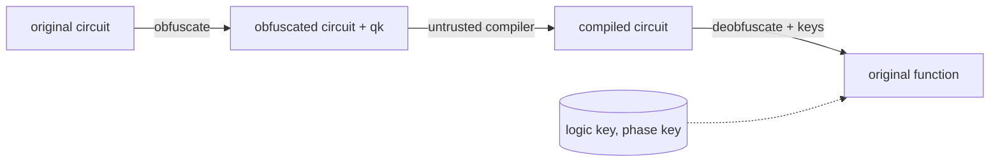

# CLOAQ - Combined Logic and Angle Obfuscation for Quantum Circuits

[](https://github.com/VinVnew/CLOAQ/actions/workflows/ci.yml)


Qiskit-based implementation of **CLOAQ** (ISCAS 2026), an IP-protection scheme for quantum
circuits that must pass through untrusted third-party compilers. It combines

* **logic obfuscation** - an ancilla key qubit `qk` that turns `X -> CX` and `CX -> CCX`
  (key bit 1) or adds an inert dummy `CX` (key bit 0), and
* **angle (phase) obfuscation** - every phase gate gets a decoy angle; its true angle
  `k*pi/4` is stored as 3 key bits, and dummy phase gates are added in idle slots,

so that a wrong key yields a functionally different circuit while the correct key restores the
original exactly.



## Install

```bash
pip install -e ".[sim]"      # library + Aer simulator
pip install -e ".[dev]"      # + tests, lint, notebook tooling
```

## Quick start

```python
from qiskit import QuantumCircuit, transpile
from qiskit_aer import AerSimulator
from cloaq import obfuscate, deobfuscate, functionally_equivalent

qc = QuantumCircuit(3, 3)
qc.x(0); qc.h(1); qc.cx(1, 2); qc.t(0); qc.s(1); qc.tdg(2); qc.cx(0, 1); qc.h(2)
qc.measure([0, 1, 2], [0, 1, 2])

circuit, logic_key, phase_key = obfuscate(qc, seed=7)      # keep the keys secret
compiled = transpile(circuit, AerSimulator(), optimization_level=0)   # untrusted compile
restored = deobfuscate(compiled, logic_key, phase_key)
assert functionally_equivalent(restored, qc)
```

`obfuscate(..., mode="logic" | "phase" | "both")` selects the stage(s); `deobfuscate` takes the
matching key(s). See [`examples/quickstart.py`](examples/quickstart.py) and the demo notebook
[`notebooks/demo.ipynb`](notebooks/demo.ipynb).

### Command line (OpenQASM 2)

```bash
cloaq obfuscate  adder.qasm -o locked.qasm -k key.json --seed 1
cloaq deobfuscate locked.qasm -k key.json -o restored.qasm
cloaq evaluate   adder.qasm            # equivalence + TVD table for logic / phase / both
```

## API

| function | purpose |
|---|---|
| `obfuscate(qc, mode, n_logic_bits, dummy_rate, seed)` | both stages; returns `ObfuscationResult(circuit, logic_key, phase_key)` |
| `deobfuscate(circ, logic_key, phase_key)` | restore the circuit (removes `qk`, dummies and barriers) |
| `logic_obfuscate` / `logic_deobfuscate` | stage 1 only (`keep_qk=True` keeps `qk` with `X` preparation gates) |
| `phase_obfuscate` / `phase_deobfuscate` | stage 2 only |
| `tvd(counts_a, counts_b)` | standard total variation distance in [0, 1] |
| `functionally_equivalent(a, b)` | exact unitary equality up to global phase |
| `simulate(qc, shots, seed)` | Aer counts (needs `qiskit-aer`) |
| `wrong_key(key, rng)` | random key that differs from `key` |

## How it works

**Logic (key bits = number of `H` gates on `qk`).** `qk` starts in `|0>`. Before each selected
gate an `H` is placed on `qk`. *Real* slot (bit 1): the `X`/`CX` is replaced by a `CX`/`CCX`
controlled by `qk`. *Dummy* slot (bit 0): `CX(qk, t)` is inserted. De-obfuscation sets `qk` to the
key bit (replacing `H` by `X` where needed), keeps real gates uncontrolled, drops dummies and
removes `qk`. Slot order is read along the `qk` wire, which is invariant under compiler reordering.

**Phase (3 key bits per `P` gate).** Z/S/Sdg/T/Tdg/P/Rz gates are replaced by `P(decoy)` with
`decoy != true angle`; the true `kappa = angle/(pi/4)` is the key. Dummy `P` gates (key `000`) are
added on idle qubits (never after a qubit's measurement) and vanish because `P(0)` is the
identity. The key is ordered by (qubit, position on that qubit's wire).

## Results

`python benchmarks/run_benchmarks.py` (QASMBench circuits, seed 1, 20 wrong keys per cell,
untrusted compile at optimisation level 0). TVD is the standard `0.5 * sum|p-q|` against the
**original** circuit.

| circuit | logic bits | phase bits | exact restore | TVD correct key | TVD wrong logic | TVD wrong phase | TVD wrong both |
|---|---|---|---|---|---|---|---|
| adder_n4 | 11 | 102 | True | 0.000 | 0.937 | 0.451 | 0.929 |
| basis_change_n3 | 16 | 75 | True | 0.000 | 0.916 | 0.877 | 0.887 |
| fredkin_n3 | 9 | 51 | True | 0.000 | 0.898 | 0.415 | 0.892 |
| wstate_n3 | 3 | 18 | True | 0.000 | 0.590 | 0.000 | 0.655 |

Numbers depend on the seed and on how many gates are locked; they are **not** the figures from
the paper/poster and key sizes differ from it (the default logic key is half the gate count).

## Limitations

* The compiler must keep the `H`/controlled/`P` gates intact: tested with optimisation level 0
  (barriers protect the key gates). Higher optimisation levels may cancel or merge dummies.
* Wrong-key corruption is circuit dependent; e.g. phase-only locking has little effect on
  `wstate_n3`, whose few phase gates barely influence the output distribution.
* Phase angles must be multiples of `pi/4` (3 bits); other angles raise `ValueError`.
* `Rz(a)` is replaced by `P(a)` (equal up to global phase).
* This is research code: it makes no formal security claims (key-recovery or structural attacks
  are out of scope here).

## Repository layout

```
src/cloaq/      library (logic.py, phase.py, pipeline.py, metrics.py, cli.py)
tests/          pytest suite (restoration, single-bit-flip, compile robustness, CLI)
examples/       quickstart.py
benchmarks/     run_benchmarks.py (downloads QASMBench on demand)
notebooks/      demo.ipynb
research/       archived research notebooks that led to this package (see below)
```

### Research archive
[`research/legacy-notebooks/`](research/legacy-notebooks/README.md) holds the original experiments
(XOR baseline, phase walls, QLL + phase prototypes) with outputs cleared, a description of each,
how they map to the package, and their known issues. They are **not maintained** and are excluded
from lint and tests.

## Citation

See [`CITATION.cff`](CITATION.cff). Benchmark circuits are from
[QASMBench](https://github.com/pnnl/QASMBench). Supported in part by the National Science
Foundation under Award 2530705.

## License

MIT - see [LICENSE](LICENSE).
